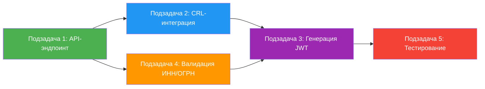

# Спецификация Jira-задачи (Task Design)

## Созданная задача

### ЗАДАЧА: SCN-001: Авторизация по КЭП — Реализация и тестирование
* **Проект:** KAN (TestAI)
* **Ключ:** KAN-3
* **Тип задачи:** Задача (Task)
* **Приоритет:** High
* **Метки:** b2b, auth, security, КЭП
* **URL:** https://polarnik21.atlassian.net/browse/KAN-3

---

## 1. Декомпозиция (Decomposition)

Требование **SCN-001 "Авторизация по КЭП"** разбито на 5 логически изолированных подзадач:

| № | Подзадача | Тип | Описание |
|---|-----------|-----|----------|
| 1 | API-эндпоинт `/api/v1/auth/kep` | Разработка | Приём и парсинг PKCS#7/CMS сообщения, базовая валидация формата и размера |
| 2 | Интеграция с УЦ (CRL-проверка) | Разработка | Запрос к УЦ для проверки статуса сертификата (таймаут 3000 мс) |
| 3 | Генерация JWT-токена | Разработка | Выпуск JWT с claims (ИНН/ОГРН) сроком жизни 15 минут |
| 4 | Валидация ИНН/ОГРН в БД ЛК | Разработка | Проверка привязки сертификата к разрешённому пользователю в базе ЛК |
| 5 | Тестирование SCN-001 | Тестирование | Покрытие функциональных тестов, граничных условий и негативных сценариев |

---

## 2. Title Engineering

**Финальный заголовок задачи:**  
`SCN-001: Авторизация по КЭП — Реализация и тестирование`

---

## 3. Формализация описания (Description Generation)

### Краткое описание
Реализовать механизм авторизации в Личном кабинете B2B-оператора связи с использованием Квалифицированной электронной подписи (КЭП). Пользователь отправляет криптографическое сообщение в формате PKCS#7 / CMS на эндпоинт `/api/v1/auth/kep`, система проверяет валидность сертификата через CRL Удостоверяющего центра, сверяет привязанный ИНН/ОГРН с базой разрешённых пользователей и выдаёт JWT-токен (срок жизни — 15 минут).

### Затрагиваемые системы
- **Backend API** — новый эндпоинт `/api/v1/auth/kep`
- **Удостоверяющий центр (внешний)** — проверка CRL (Certificate Revocation List)
- **База данных ЛК** — таблица разрешённых пользователей (ИНН/ОГРН)
- **Auth Service** — генерация JWT-токенов

### API-спецификация

**POST** `/api/v1/auth/kep`  
**Content-Type:** `application/pkcs7-signature` или `application/cms`

#### Временные лимиты
| Параметр | Значение |
|----------|----------|
| max_execution_timeout_ms | 5000 мс |
| crl_check_timeout_ms | 3000 мс |
| token_lifetime_minutes | 15 мин |

#### Статус-коды ответов
| Код | Статус | Описание |
|-----|--------|----------|
| 200 | OK | Успешная авторизация. Возвращается JWT-токен |
| 400 | Bad Request | Неверный формат PKCS#7/CMS или размер файла > 10 МБ |
| 401 | Unauthorized | Сертификат отозван УЦ, повреждён или истёк срок действия |
| 403 | Forbidden | Сертификат валиден, но ИНН/ОГРН отсутствует в базе разрешённых пользователей ЛК или учётная запись заблокирована |
| 504 | Gateway Timeout | Не удалось проверить сертификат по CRL (таймаут > 3000 мс) |

#### Boundary Conditions
1. Срок действия сертификата КЭП истекает сегодня или уже истёк (разница с current_time <= 0)
2. Размер публичного ключа и цепочки сертификатов превышает 10 МБ
3. CRL-сервер УЦ недоступен (таймаут ответа > 3000 мс)

---

## 4. Критерии приемки (Acceptance Criteria)

### Для подзадачи 1: API-эндпоинт `/api/v1/auth/kep`
- [ ] Эндпоинт принимает PKCS#7/CMS сообщение через POST-запрос
- [ ] Реализована валидация Content-Type: `application/pkcs7-signature` или `application/cms`
- [ ] При невалидном формате сообщения возвращается **400 Bad Request**
- [ ] При превышении размера 10 МБ возвращается **400 Bad Request**
- [ ] Время выполнения запроса не превышает 5000 мс

### Для подзадачи 2: Интеграция с УЦ (CRL)
- [ ] Реализован запрос к CRL-серверу УЦ для проверки статуса сертификата
- [ ] При отозванном сертификате возвращается **401 Unauthorized**
- [ ] При повреждённом сертификате возвращается **401 Unauthorized**
- [ ] При истекшем сроке сертификата возвращается **401 Unauthorized**
- [ ] При недоступности CRL-сервера (> 3000 мс) возвращается **504 Gateway Timeout**
- [ ] При таймауте ответа УЦ логируется ошибка интеграции

### Для подзадачи 3: Генерация JWT
- [ ] При успешной авторизации возвращается JWT-токен (статус **200 OK**)
- [ ] Время жизни токена составляет ровно 15 минут
- [ ] Токен содержит claims с ИНН/ОГРН пользователя
- [ ] Токен подписан с использованием валидного ключа (RS256/ES256)

### Для подзадачи 4: Валидация ИНН/ОГРН в БД ЛК
- [ ] Реализована проверка ИНН/ОГРН из сертификата по БД разрешённых пользователей
- [ ] Если ИНН/ОГРН не найден в БД — возвращается **403 Forbidden**
- [ ] Если учётная запись заблокирована — возвращается **403 Forbidden**
- [ ] Для валидного и разрешённого пользователя возвращается **200 OK** с JWT

### Для подзадачи 5: Тестирование
- [ ] Покрыты позитивные сценарии (валидный сертификат → JWT)
- [ ] Покрыты граничные случаи (истекающий/истекший сертификат)
- [ ] Покрыты негативные сценарии (отозванный сертификат, большой размер, таймаут CRL)
- [ ] Покрыты тесты на блокировку/отсутствие пользователя в БД
- [ ] Проверены временные лимиты (5000 мс общий, 3000 мс CRL)
- [ ] Тесты на API-аутентификацию выполняются изолированно (mock УЦ)

---

## 5. Dependency Mapping (Зависимости)

| Подзадача | Блокируется | Разблокирует | Параллельно |
|-----------|-------------|--------------|-------------|
| 1. API-эндпоинт | — | 2, 4 | — |
| 2. CRL-интеграция | 1 | 3 | 4 |
| 3. Генерация JWT | 2, 4 | 5 | — |
| 4. Валидация ИНН/ОГРН | 1 | 3 | 2 |
| 5. Тестирование | 3 | — | — |

---

## Результат

- **Ключ задачи:** KAN-3
- **URL:** https://polarnik21.atlassian.net/browse/KAN-3
- **Статус:** Создана
